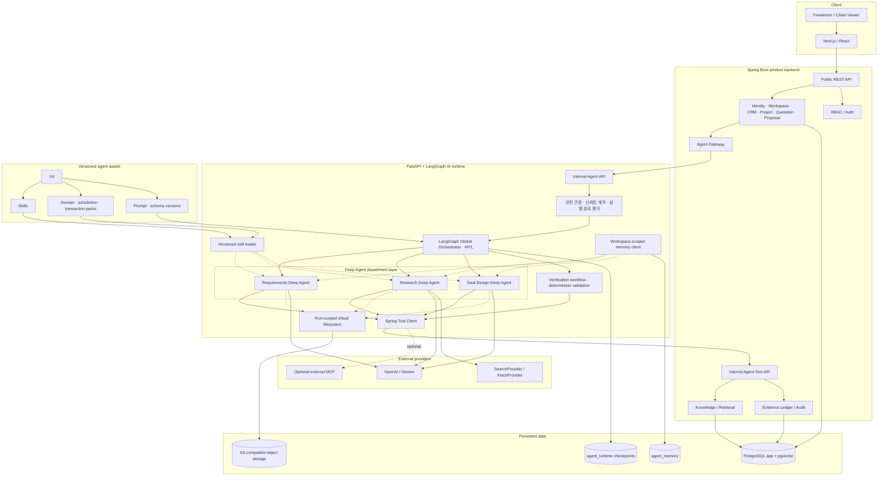

# Deep Agents 기반 V2 목표 구조

> 상태: ADR-0013의 목표 구조·비교 후보. 운영 적용 완료를 뜻하지 않음\
> 기준일: 2026-08-13

이 문서는 사용자 승인 다이어그램을 저장소의 V2 경계와 구현 단위로 옮긴 목표 구조다.
구현 우선순위와 강제 제약은 [ADR-0013](../adr/0013-deep-agents-department-runtime.md)을
따른다.

## 현재 구현과의 차이

2026-10-16 기준 `deepagents`는 개발 의존성이고 Research 후보는 `agent/src/departments`에서 비교한다. 운영 실행은 `agent/src/graph`와 `agent/src/runtime`의 제한 실행기를 사용한다. 아래 `agent_memory`, S3 원본 보관·외부 MCP는 목표 설계이며 현재 운영 구성요소로 단정하지 않는다.

초기 그림의 encoder 우선 라우팅은 [ADR-0015](../adr/0015-llm-first-operational-routing.md)와 [ADR-0028](../adr/0028-trusted-contract-routing-fast-path.md)의 안전 관문·신뢰된 계약·기타 요청 평가로 보완됐다. 신규 제공사는 OpenAI만 허용하고 V47 개인 키 실행은 별도 로컬 라우팅을 사용한다. 현재 서비스 구조는 [V2 명세](../V2_SPECIFICATION.md)를 함께 확인한다.

## 2026-08-13 목표 구조

## 책임 경계

| 계층                        | 소유 책임                                                                 |
| --------------------------- | ------------------------------------------------------------------------- |
| Spring Boot                 | 인증, workspace RBAC, 업무 transaction, 견적 계산, Evidence Ledger, audit |
| Hybrid Routing Gateway      | 정책 gate 이후 실행 route 선택과 abstain/fallback                         |
| Global Orchestrator         | 부서 선택, 상태 전이, 중앙 budget, HITL, 결과 조정                        |
| Department Deep Agent       | 자기 부문의 계획, context 관리, 허용 specialist·Tool 실행                 |
| Verification workflow       | evidence·risk·계산 결과의 독립 검증과 승인 조건 판정                      |
| PostgreSQL / object storage | 업무 데이터, checkpoint, 승인 memory, 근거와 산출물 영속화                |

## 도입 시 검토 순서

1. 개발 의존성의 `deepagents 0.7.5`와 최소 Research 후보로 호환성을 비교한다.
2. general-purpose subagent·shell을 끄고 run-scoped backend와 명시적 specialist를 구성한다.
3. read-only Spring Tool client, structured output, checkpoint와 budget contract를 연결한다.
4. 단일 ReAct baseline과 frozen evaluation을 수행한다.
5. ADR-0013 acceptance criteria를 통과하면 Research를 승격한다.
6. 같은 절차로 Requirements와 Deal Design을 검토한다.

운영 FAISS, Python의 business table 직접 접근, 자유로운 swarm과 자동 model fallback은 이
구조에 포함되지 않는다.
